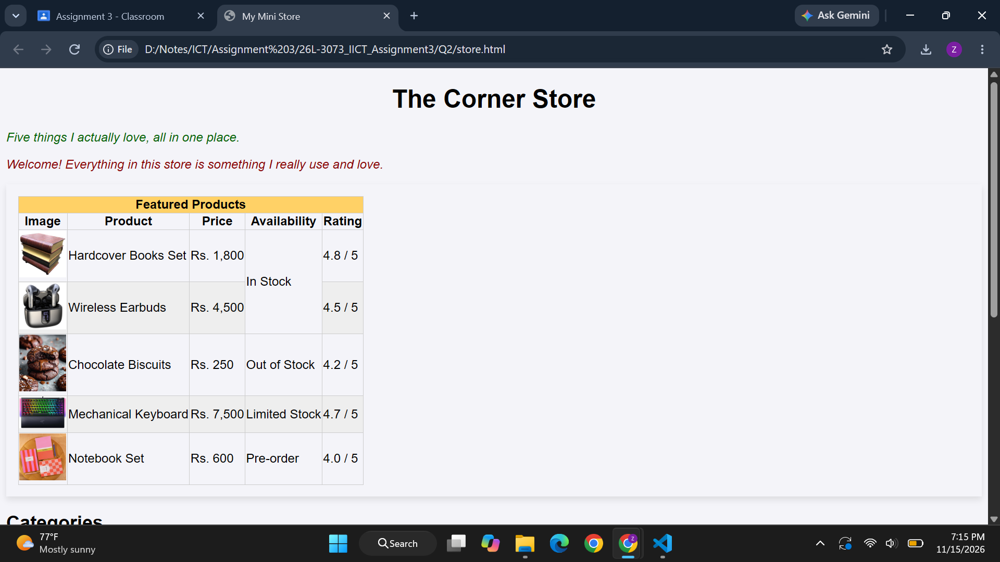
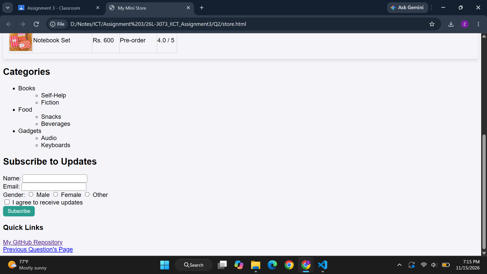

# My Mini Store

The Corner Store is a one-page online storefront that sells five items I actually love. It shows the products in a styled table, with categories, a subscribe form and quick links.

## Part 11: Precedence Check

**Tagline paragraph colour:** dark green (#006400).
**Other `
` tags colour:** dark red (#8b0000), in italics.

**Why:**
1. Inline CSS (`style="color: #006400;"`) has the highest specificity, so the tagline stays green: inline > internal > external.
2. The internal `<style>` rule beats the external `store.css` rule (#555) because it comes later with equal specificity.
3. So the external gray is overridden everywhere: the tagline is green and all other paragraphs are dark red.

## Screenshot

